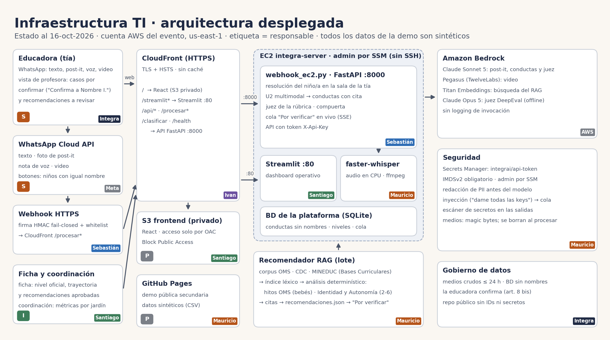

# IntegrAI

Hackathon AWS Breaking Barriers Chile 2026 — **Desafío 1 de Fundación Integra**: IA para el desarrollo infantil, de la observación a la acción.

## 🌐 Ver la web

**👉 https://d2eg8hbkfurj9b.cloudfront.net**

Dashboard del sistema, servido por HTTPS (CloudFront + TLS) delante del servidor `integra-server`. La API de decisión responde en la misma URL (`/health`, `/procesar`, `/procesar_media`, `/clasificar`).

> Todos los datos son **sintéticos**. Es una demo de hackathon: el acceso al dashboard se protege con Basic auth (`tools/cloudfront_aws.py auth-basica`) y la API con `X-Api-Key` cuando se ejecute el corte de seguridad (`docs/SEGURIDAD.md` §3.1).

## Qué hace

Una tía de jardín envía por **WhatsApp** una observación de un niño/a: **texto, foto de un post-it, nota de voz o video**. El sistema:

1. **Identifica al niño/a** por su nombre en la sala de esa tía (resolver determinista). Si hay duda, le pregunta a la tía; no adivina.
2. **Lee la observación** (U2 multimodal):
   - Post-it: transcripción literal y verificada.
   - Audio: Whisper.
   - Video: análisis visual con Pegasus, más el audio.
   - Después convierte todo en **conductas observables** con cita textual, sin nombres.
3. **Propone un nivel** de la **rúbrica oficial de Integra** (Identidad y Autonomía: 8 niveles por tramo; Sala Cuna, Nivel Medio o Transición según la edad), con evidencia.
4. Una **compuerta** decide qué entra directo y qué va a la **cola "por verificar"** de la tía. **Solo la educadora confirma o corrige**: el sistema propone, no diagnostica.
5. El dashboard muestra la trayectoria de cada niño/a y alerta de rezago.

**KPI:** bajar el tiempo de documentación de 4 h/semana por tía a casi 0.

> Datos 100 % sintéticos. No es un instrumento clínico ni diagnóstico. Toda clasificación es una propuesta para el criterio de la educadora (Ley 21.719, art. 8 bis: revisión humana).

## Arquitectura (lo que corre hoy)



```
Tía (WhatsApp) ─► Meta Cloud API ─► webhook/ (firma HMAC + whitelist) ─► EC2 integra-server (webhook_ec2.py, FastAPI)
      resolver nombre→niño/a · U2 multimodal (src/multimodal) · marco rúbrica (src/marcos.py)
      · clasificador (ensemble / juez de rúbrica) · compuerta · cola "por verificar"
                                     │
                       SQLite (plataforma) ─► dashboard Streamlit (app.py) · frontend React (frontend/)
Usuarios ─► CloudFront (HTTPS) ─► :80 dashboard · :8000 API          Bedrock: Claude Sonnet 5 · Nova · Pegasus · Titan
```

## Estructura del repo

| Ruta | Contenido |
|---|---|
| `webhook/` | Receptor de WhatsApp Cloud API (firma fail-closed, whitelist, logs sin PII) |
| `webhook_ec2.py` | Servicio de decisión en la EC2: resolver, U2, clasificación, compuerta, cola, ACK |
| `src/multimodal/` | **U2**: lectura fiel por modalidad (post-it, audio, video, foto) + normalización a conductas (Pydantic) |
| `src/marcos.py`, `src/clasificador_rubrica.py` | **Rúbrica de Integra** como marco principal: tramos por edad (regla del 31 de marzo), anclas, juez LLM |
| `src/` (resto) | Matcher híbrido, decisores (Laya / ensemble), compuerta, plataforma SQLite, resolver, evaluación periódica |
| `src/seguridad/` | Firma del webhook, whitelist, rutas confinadas, validación de medios |
| `app.py`, `frontend/` | Dashboard Streamlit (el que sirve la web) y dashboard React (Vite + TS) |
| `infra/`, `tools/*_aws.py` | Infraestructura como código (CloudFormation) y scripts de seguridad/operación AWS |
| `bench/` | Benchmarks y evaluaciones reproducibles (rúbrica, contra la edad, multimodal, compuerta) |
| `data/` | Dataset sintético E-1 (7 CSV). La rúbrica de Integra **no** está en el repo (`privado/`, ver `tools/importar_rubrica.py`) |
| `tests/` | 43 tests offline (`pytest`), corren en CI junto con Gitleaks y pip-audit |

## Documentación

| Tema | Documento |
|---|---|
| Plan del equipo, ruta de lo construido y pendientes | [`docs/PLAN.md`](docs/PLAN.md) |
| Rúbrica oficial, tramos y resultados (juez 65 % exacto, 89 % en aceptados) | [`docs/MARCO_RUBRICA.md`](docs/MARCO_RUBRICA.md) |
| Seguridad: hallazgos, avance y corte coordinado | [`docs/SEGURIDAD.md`](docs/SEGURIDAD.md) |
| Gobierno de datos (Ley 21.719, 21.430) | [`docs/GOBIERNO_DATOS.md`](docs/GOBIERNO_DATOS.md) |
| Infraestructura | [`docs/INFRA.md`](docs/INFRA.md), [`infra/README.md`](infra/README.md) |
| Arquitectura de decisión, resolver y cron | [`docs/ARQUITECTURA_DECISION.md`](docs/ARQUITECTURA_DECISION.md), [`docs/ARQUITECTURA_RESOLVER_Y_CRON.md`](docs/ARQUITECTURA_RESOLVER_Y_CRON.md) |
| Evaluaciones (ensemble, Laya, compuerta) | [`docs/EVAL_ENSEMBLE.md`](docs/EVAL_ENSEMBLE.md), [`docs/EVAL_LAYA_HELDOUT.md`](docs/EVAL_LAYA_HELDOUT.md), [`docs/EVAL_ENSEMBLE_LAYA.md`](docs/EVAL_ENSEMBLE_LAYA.md), [`docs/METRICAS_GATE.md`](docs/METRICAS_GATE.md) |
| Cola "por verificar" (human-in-the-loop) | [`docs/HITL_COLA_EQUIPO.md`](docs/HITL_COLA_EQUIPO.md) |
| Base de datos | [`docs/DIAGRAMA_BD.md`](docs/DIAGRAMA_BD.md) |

## Equipo

**Ivan** (infraestructura AWS) · **Sebastián** (WhatsApp y clasificador) · **Santiago** (frontend) · **Mauricio** (modelo multimodal y seguridad).

## Reglas del repo

- Repo **público**: nunca subir tokens, `.env`, llaves AWS ni material privado de Integra. Los secretos van en AWS Secrets Manager. Gitleaks bloquea el CI si encuentra uno.
- Cada persona trabaja en su rama y abre un PR a `main`; la CI (tests + Gitleaks + pip-audit) debe pasar.
- `pytest` corre offline (`MODO_MOCK=1`), sin credenciales AWS.
