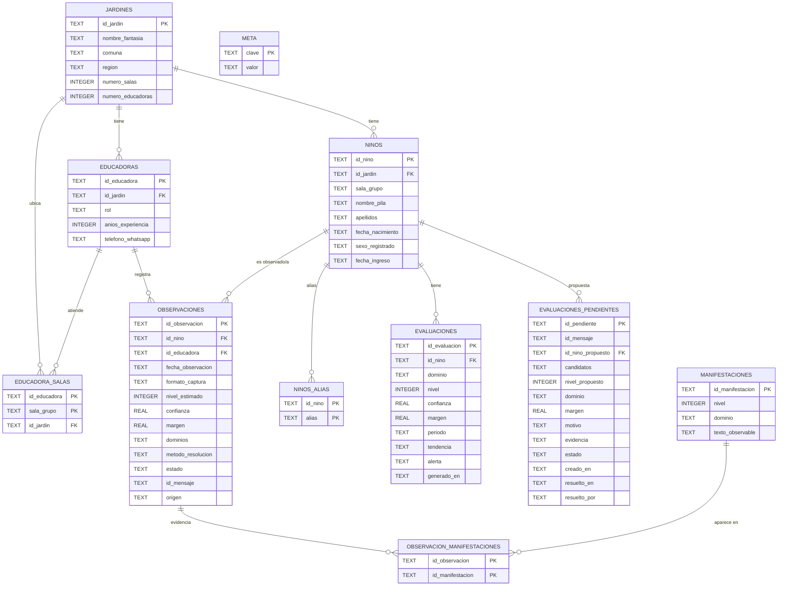

# 🗄️ Diagrama relacional de la base de datos — IntegrAI

> **Para:** equipo de UI/UX. **Qué es:** el modelo de datos completo del backend
> (SQLite hoy → Aurora/DynamoDB en producción) con los enums, el flujo de datos y
> las **consultas exactas** que alimentan cada pantalla.
>
> *Fuente autoritativa:* `src/plataforma.py` (esquema + migraciones) y la BD real
> (`integra-server`, JAR-0001).

---

## 1. Diagrama entidad–relación

> Rinde nativo en GitHub. Versión exportada: `diagrama_bd.svg` / `diagrama_bd.png`.



> ℹ️ `MANIFESTACIONES` **no** es una tabla SQL: es el catálogo (90 manifestaciones,
> 9 niveles × 10) que vive en `data/manifestaciones.json`. Se dibuja porque
> `observacion_manifestaciones` la referencia.

---

## 2. Las tablas, en lenguaje de producto

### 🏫 `jardines` — *(20 filas)*
El establecimiento. Raíz de toda la jerarquía.
`id_jardin` · nombre, comuna, región, nº de salas y educadoras.

### 👩‍🏫 `educadoras` — *(81 filas)*
Quien usa el sistema. **`telefono_whatsapp`** es la llave del mapeo *tía → sala*.
`id_educadora` · `id_jardin` · `rol` · `anios_experiencia` · `telefono_whatsapp`.

### 🔗 `educadora_salas` — *(2 filas)*
Puente **N:M** educadora ↔ sala (una tía puede cubrir varias salas).
`id_educadora` + `sala_grupo` (PK) · `id_jardin`.

### 🧒 `ninos` — *(500 filas)*
El centro de la UI. `nombre_pila` + `apellidos` son lo que el **resolver** usa para
identificar; el homónimo se resuelve por apellido.
`id_nino` · `id_jardin` · `sala_grupo` · nombre/apellidos · fecha_nacimiento · sexo · ingreso.

### 🏷️ `ninos_alias` — *(0 filas)*
Diminutivos/apodos («Nacho» → «Ignacio») para el resolver. `id_nino` + `alias`.

### 📝 `observaciones` — *(2.960 filas)* ← **la tabla que más mueve la UI**
Cada registro que llega (dataset o WhatsApp). **Cada fila es un ítem del timeline.**
`id_observacion` · `id_nino` · `id_educadora` · `fecha_observacion` · `formato_captura`
(note/foto/audio/video) · `nivel_estimado` · `confianza` · **`margen`** · `dominios` ·
**`metodo_resolucion`** · **`estado`** · `id_mensaje` (idempotencia) · `origen`.

### 🧩 `observacion_manifestaciones` — *(8.850 filas)*
Evidencia: qué manifestaciones del catálogo dispararon la observación (M:N).
`id_observacion` + `id_manifestacion`.

### 📈 `evaluaciones` — *(0 filas)*
**Nivel canónico** del niño por período (lo que ve la familia/dirección). Lo escribe
el **cron** (cuando el margen es alto) o la tía (cuando aprueba un pendiente).
`id_evaluacion` · `id_nino` · `dominio` · `nivel` · `confianza` · `margen` · `periodo` ·
**`tendencia`** · **`alerta`** · `generado_en`.

### ⏳ `evaluaciones_pendientes` — *(0 filas)* ← **la cola "POR VERIFICAR"**
El **human-in-the-loop**: cuando el margen es bajo, NO se decide solo → queda acá para
que la tía apruebe/edite/rechace.
`id_pendiente` · `id_mensaje` · `id_nino_propuesto` · `candidatos` (JSON) ·
`nivel_propuesto` · `dominio` · `margen` · `motivo` · `evidencia` · **`estado`** ·
`creado_en` · `resuelto_en` · `resuelto_por`.

### ⚙️ `meta` — *(0 filas)*
Key-value interno: `cron_watermark_rowid` (por dónde va el cron). No visible al usuario.

---

## 3. Enums (valores válidos)

| Tabla.campo | Valores | Significado para la UI |
|---|---|---|
| `observaciones.estado` | `auto` · `por_verificar` · `verificado` | auto = decidido; por_verificar = ojo de la tía; verificado = confirmado |
| `observaciones.origen` | `dataset` · `whatsapp` | de dónde vino |
| `observaciones.metodo_resolucion` | `exacto` · `ambiguo` · `no_encontrado` | cómo se identificó al niño |
| `observaciones.formato_captura` | `texto` · `imagen` · `audio` · `video` | ícono del timeline |
| `evaluaciones.tendencia` | `avance` · `retroceso` · `estable` · `sin_historial` | flecha ↑ ↓ = en el perfil |
| `evaluaciones_pendientes.estado` | `pendiente` · `aprobado` · `editado` · `rechazado` | estado de la cola |
| `evaluaciones_pendientes.motivo` | `margen_bajo` | por qué escaló |
| `evaluaciones.alerta` | texto (ej. *"Retroceso: 5 → 3"*) | bandera roja |

---

## 4. Flujo de datos (WhatsApp → BD → UI)

```
Tía (WhatsApp) ─► receptor (firma+dedupe) ─► EC2 /procesar
     │  from = nº de la tía
     ▼
RUTEO:  educadoras.telefono_whatsapp ─┐
        educadora_salas ──────────────┴─► sala(s) ─► roster de `ninos`
     ▼
RESOLVER (determinista): nombre → id_nino   (ambiguo ⇒ pide apellido, NO registra)
     ▼
DECISIÓN: híbrido ⊕ Laya → nivel + MARGEN
     ▼
registrar_observacion → `observaciones` (estado = auto | por_verificar)
     ▼  (una vez al día)
CRON → margen alto  → `evaluaciones`            (canónico)
       margen bajo  → `evaluaciones_pendientes` (cola POR VERIFICAR)
                     + tendencia / alerta de rezago
```

---

## 5. Guía para UI/UX — pantallas y sus consultas

| # | Pantalla | Datos | Query base |
|---|---|---|---|
| **1** | **Jardín → Sala → Roster** | niños de una sala | `SELECT * FROM ninos WHERE id_jardin=? AND sala_grupo=?` (`roster_sala`) |
| **2** | **Perfil del niño / timeline** | sus observaciones | `SELECT * FROM observaciones WHERE id_nino=? ORDER BY fecha_observacion` (`observaciones_de`) |
| **3** | ⏳ **Cola "POR VERIFICAR"** | pendientes | `SELECT * FROM evaluaciones_pendientes WHERE estado='pendiente' ORDER BY creado_en` (`pendientes`) |
| **4** | **Trayectoria + alertas** | historia consolidada | `trayectoria(id_nino)` + `SELECT * FROM evaluaciones WHERE id_nino=?` |
| **5** | **Admin · vincular WhatsApp** | números→salas | `educadoras.telefono_whatsapp` + `educadora_salas` (`vincular_whatsapp`, `ruta_de_whatsapp`) |
| **6** | **Panorama / dirección** | KPIs | `panorama()` + `resumen()` (conteos por tabla) |

### Pantalla 3 (la joya: human-in-the-loop)
Cada tarjeta de la cola debe mostrar: **niño** (`id_nino_propuesto`), **nivel propuesto**,
**margen** (barra de confianza), **motivo** (`margen_bajo`), **evidencia** (texto + dominios),
y 3 acciones → `resolver_pendiente(id_pendiente, "aprobado"|"editado"|"rechazado", ...)`.
Aprobar/editar **escribe en `evaluaciones`** automáticamente.

### Estados vacíos a considerar
`evaluaciones`, `evaluaciones_pendientes`, `ninos_alias`, `meta` están **en 0** hoy →
la UI debe manejar "sin datos" con gracia (recién se pueblan cuando corre WhatsApp/cron).

---

## 6. Notas técnicas

- **Jerarquía:** `jardines › (sala_grupo) › ninos › observaciones › observacion_manifestaciones`.
- **La sala no está normalizada como tabla:** es un campo texto (`ninos.sala_grupo` y
  `educadora_salas.sala_grupo`). Si UI necesita una vista de salas, agrupar por ese texto.
- **Idempotencia:** `ux_obs_msg` (índice único sobre `observaciones.id_mensaje`) evita
  duplicar mensajes reenviados por WhatsApp.
- **Producción:** SQLite → **Aurora (relacional) o DynamoDB**. La interfaz de
  `Plataforma` se mantiene; solo cambia la capa de acceso.

---
*Generado por Shiva · IntegrAI (AWS Breaking Barriers Chile 2026) · 15-oct-2026.*
